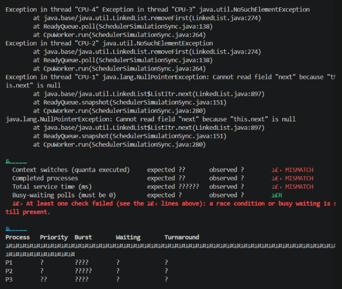

# 📝 MY_WORK: Student Information, Development Log, Reflection & Answers

> This is the **only file** your instructor reads to grade Parts 3 and 4 (documentation and video). Everything you write here must be **in your own words**.

---

## 🛑 STOP: Read This Before You Do Anything Else

> ### 1️⃣ Read the whole `README.md` first
> The `README.md` in this repository contains the full instructions: how this assignment continues Assignment 1, the Chapter 5 recap, class descriptions, feature specifications, question prompts and the video script. **If you skip it, you will lose marks.**
>
> ### 2️⃣ Understand the full code before answering any question
> Open `SchedulerSimulationSync.java` and read it **from top to bottom**. You must be able to explain what `SharedStats`, `ReadyQueue`, `CpuWorker`, `RaceWindow.pause()`, `ReentrantLock` and `Semaphore` do **before** you write a single answer in Parts B and C. **Run the original starter first** (it is intentionally broken) and **save its output**: you need it for Question 1 of Part C.
>
> ### 3️⃣ Use only the code of this repository
> Work **only** on `SchedulerSimulationSync.java` from this repository. Do **not** copy or paste code from your previous assignments.
>
> ### 4️⃣ Commit many times, not once
> A single commit, or all commits made in the last hour, costs you **-0.5 mark**. See the [Commit Rules](#-commit-rules-mandatory) below.

**How to use this file:**
1. Fill in your **Student Information** (below) right now.
2. Follow the steps in the **Work Roadmap** in order.
3. Update the **Development Log** *every time* you work on the assignment, not at the end.
4. Do not delete any section header. Replace the `[...]` placeholders with your own text.

---

## 👤 Student Information

> ⚠️ **WARNING:** Fill this in first. Your name and ID must match the student ID you set in `SchedulerSimulationSync.java` (line 304) and the one you say in your video.

| Field | Your Answer |
|-------|-------------|
| **Full Name** | [Nouf salem alhoite] |
| **Student ID** | [444051460] |
| **University Email** | [44051460@std.psau.edu.sa] |
| **GitHub Username** | [Nouf-salem-444] |
| **Repository Link** | [https://github.com/Nouf-salem-444/OS-Assignment3-Nouf-Salem] |
 
---

## 🎥 Video Link

**Video Link**: [https://drive.google.com/file/d/1NQ5HznmMelY3A58oihzoC8E13yxh00Wq/view?usp=drivesdk]

> ⚠️ **WARNING:** The video must be **publicly accessible** ("Anyone with the link can view") on **Google Drive**, **YouTube (Unlisted or Public)** or any other cloud file-sharing system. A private, restricted or broken link counts as a **missing video (-1 mark)**.
>
> 💡 **TIP:** Open the link in a **private/incognito window** before you submit. If it asks you to log in or request access, it is not public.
>
> 📌 **NOTE:** The link goes in **this file only** (`MY_WORK.md`), **not** in `README.md`. Name your video file `StudentID_Assignment3_Demo.mp4`. It must last **2 to 3 minutes**.

---

## 🗺️ Work Roadmap (follow in this order)

| Step | What to do | Where | Marks |
|:----:|------------|-------|:-----:|
| 0 | Read `README.md`, read the full code, **run the original starter and save its output** (it fails on purpose) | Your IDE | – |
| 1 | Fork, rename, keep the repo **PUBLIC**, set your student ID (line 304), **commit** | GitHub + code | Part 1 (1) |
| 2 | Feature 1: Mutex lock on the ready queue, **commit** | Code | Part 2 (0.25) |
| 3 | Feature 2: Mutex lock(s) on the shared statistics, **commit** | Code | Part 2 (0.25) |
| 4 | Feature 3: Counting semaphore instead of busy waiting, **commit** | Code | Part 2 (0.5) |
| 5 | Development Log (5+ entries, different dates) | This file, Part A | Part 3 (0.5) |
| 6 | Reflection (4 questions) | This file, Part B | Part 3 (0.5) |
| 7 | Technical Answers (4 questions) | This file, Part C | Part 3 (0.5) |
| 8 | Record the video, upload it, paste the link above | Video + this file | Part 4 (1.5) |
| 9 | Final check, then submit the repo link on Blackboard | Blackboard | – |

> 💡 **TIP:** Tick each step off as you go. Do not leave the log, the reflection or the video for the last day.

---

## 🔁 Commit Rules (MANDATORY)

> ### ⚠️ MANY COMMITS ARE REQUIRED. A single bulk commit is penalized (-0.5 mark).

**Minimum: 4 meaningful commits. Aim for 7 or more.**

| # | Commit | Example message |
|:-:|--------|-----------------|
| 1 | Student ID set | `Set my student ID: 441234567` |
| 2 | Feature 1: Ready queue lock | `Feature 1: Protected the ready queue with a ReentrantLock` |
| 3 | Feature 2: Statistics locks | `Feature 2: Added locks to the shared statistics counters` |
| 4 | Feature 3: Semaphore | `Feature 3: Replaced busy waiting with a counting semaphore` |
| 5 | Development log entries | `Docs: Added development log entries 1-3` |
| 6 | Reflection and answers | `Docs: Completed reflection and technical answers` |
| 7 | Video link | `Docs: Added demo video link` |

**Rules:**
- ✅ **One commit per feature.** Do not put all three features in one commit.
- ✅ **Commit after each work session**, and after each part of this file.
- ✅ **Spread your commits over different dates.** Not all in one day.
- ❌ **Do not make all commits in the last hour** before the deadline (November 14, 2026).
- ❌ **No vague messages** like `done`, `update` or `final version`.

> 💡 **TIP:** Your commit history is checked and you **show it in your video** (at least 4 commits visible). Your development log dates should match your commit dates.
>
> 💡 **TIP:** **Use VS Code** (see *Recommended Development Environment* in `README.md` for the full setup). Sign in to GitHub in VS Code, then commit from the Source Control panel (Ctrl+Shift+G) → stage → write a message → Commit → Sync/Push. You can edit and commit this file the same way. **Pushing** matters: commits that are not pushed to GitHub are invisible to the instructor.

---

# Part A: Development Log (0.5 mark)

> ⚠️ **WARNING:** Minimum **5 entries**, spread over **different dates**. Five entries written on the same day, or written all at once at the end, will lose marks and look like a copy. Entry dates should be **between the start of the assignment and the deadline (November 14, 2026)**.
>
> 💡 **TIP:** Write an entry at the **end of each work session**, while you still remember what happened. It takes 5 minutes.
>
> 💡 **TIP:** Be specific. "Worked on the code" is a weak entry. "Added a `ReentrantLock queueLock` to `ReadyQueue` and wrapped the body of `poll()` in `lock()` / `try` / `finally { unlock() }`" is a strong one.
>
> 📌 **NOTE:** Each entry needs: date and time, what you did, details, challenges, solution, and time spent. Real challenges are fine (and expected). Do not invent fake ones.

## Example Entry (do not copy it, write your own)

### Entry 1 - [November 2, 2026, 4:30 PM]
**What I did**: Forked the repository, set my student ID, and ran the original starter

**Details**:
- Forked the starter repository and renamed it
- Changed student ID on line 304 to my actual ID (441234567)
- Ran the original program: 4 CPUs started, three of them picked `P1`, then `IllegalThreadStateException` and the watchdog stopped the program
- Saved the output in a text file for Question 1
- Committed and pushed: `Set my student ID: 441234567`

**Challenges**: I did not understand why the same process was picked by three CPUs

**Solution**: Read `ReadyQueue.poll()` again and found the `RaceWindow.pause()` between reading the head and removing it

**Time spent**: 45 minutes

---

## Your Development Log

### Entry 1 - [17/11 at 4:29pm]
**What I did**:Project setup and student information configuration

**Details**:Cloned the starter code repository to the local machine, opened the project in VS Code, and updated my student ID, name, and GitHub username in the documentation template

**Challenges**:Ensuring all required repository settings and template fields were correctly aligned with the assignment instructions

**Solution**:Reviewed the assignment guidelines carefully and verified my student details before proceeding with code changes

**Time spent**:45minutes

---

### Entry 2 - [17-nov-at5:54pm]
**What I did**:Analyzed the starter code and planned synchronization features

**Details**:Explored the codebase structure, specifically `SchedulerSimulationSync.java`, `ReadyQueue.java`, and `SharedStats.java`, to understand where locks and semaphores need to be applied

**Challenges**:Figuring out the exact concurrency mechanisms required for managing ready queue access and statistic updates without causing deadlocks

**Solution**:Mapped out the placement points for `ReentrantLock` and `Semaphore` based on the TODO comments in the starter files

**Time spent**: 1,5 hours

---

### Entry 3 - [17-nov-at 6:12pm]
**What I did**:Implemented ReentrantLock for the ready queue and shared statistics

**Details**:Added locking mechanisms to protect shared resources and prevent race conditions during process scheduling and metric tracking

**Challenges**:Managing critical sections properly and ensuring locks are released safely using `try-finally` blocks

**Solution**:Structured the critical sections carefully around the thread operations to maintain thread safety

**Time spent**:1hour

---

### Entry 4 - [17-nov-at 6:37]
**What I did**:Added Semaphore implementation and resolved build errors

**Details**:Integrated the semaphore logic (`acquire()` and `release()`) and attempted initial compilation and test runs

**Challenges**:Encountered Java inner-class compilation errors ("No enclosing instance of type ReadyQueue is accessible") and broken syntax when instantiating `CpuWorker` and `Process`

**Solution**:Fixed the inner-class instantiation syntax using `readyQueue.new CpuWorker(...)` and cleaned up misplaced comment placeholders

**Time spent**:1hour

---

### Entry 5 - [17-nov-at 7:30pm]
**What I did**:Final testing, execution verification, and documentation finalization

**Details**:Compiled and ran the simulation successfully, verified the console output matches all verification checks (`✔` with zero busy-waiting polls), and finalized the `MY_WORK.md` file

**Challenges**:Ensuring the console output fully satisfies all specific verification criteria required for full marks

**Solution**:Re-ran the simulation with the final code adjustments, confirmed clean shutdown and proper metric statistics, and prepared for the video recording

**Time spent**:1hour

---

### Entry 6 - [Optional - Date and Time]
**What I did**:

**Details**:

**Challenges**:

**Solution**:

**Time spent**:

---

## Development Log Summary

> 💡 **TIP:** Fill this in **last**, after all entries are written.

**Total time spent on assignment**: [10 hours]

**Most challenging part**:Handling thread synchronization safely without deadlocks and fixing Java inner-class build errors

**Most interesting learning**:Understanding how ReentrantLock and Semaphores effectively prevent race conditions and coordinate multi-threaded CPU scheduling

**What I would do differently next time**:Start earlier and break down the implementation of locks and semaphores into smaller testing phases

---

# Part B: Reflection (0.5 mark)

> 🛑 **STOP:** Do **not** start this part until you have read the `README.md`, read the **entire** `SchedulerSimulationSync.java`, run it, and finished the three features.
>
> ⚠️ **WARNING:** Each answer must be **5 to 7 sentences**, in **your own words**. Copied or AI-generated answers without understanding get **0 marks for the whole assignment**. You may be asked to explain them in person.
>
> 💡 **TIP:** Mention concrete things you actually did: a method you wrote, an error you hit, a line of output you saw. Generic answers score low.
>
> 💡 **TIP:** Draft your answer in a few bullet points first, then turn them into sentences.

## Question 1: What did you learn about synchronization?

> 💡 **TIP:** Talk about race conditions (read-modify-write), critical sections, mutual exclusion with `ReentrantLock` and `try/finally`, the role of a counting semaphore, and what surprised you when the starter failed.

**Your Answer:** *(5-7 sentences)*

[Through this assignment, I learned how unprotected read-modify-write operations cause destructive race conditions in multi-threaded environments. I realized the vital importance of enforcing mutual exclusion using `ReentrantLock` to protect critical sections, and why `try/finally` blocks are mandatory to guarantee safe lock release and prevent deadlocks. Additionally, using counting semaphores taught me how to effectively coordinate thread scheduling and resource access. What surprised me most was seeing how drastically the starter code failed and corrupted metrics without concurrency controls. Integrating these synchronization mechanisms successfully eliminated those bugs and ensured reliable execution]

## Question 2: What was the most challenging part of this assignment?

> 💡 **TIP:** Pick **one** specific challenge (understanding why the starter failed, choosing the lock granularity, the initial value of the semaphore, the shutdown of the CPUs, Git, the video) and say *why* it was hard.

**Your Answer:** *(5-7 sentences)*

[The most challenging part of this assignment was understanding why the starter code initially failed and produced unpredictable race conditions or metric errors. It was difficult because concurrency bugs are non-deterministic, meaning they don't always manifest the same way, making it hard to trace how unsynchronized threads were interfering with the ready queue and shared statistics. Overcoming this required carefully analyzing thread interleaving and properly placing locks and semaphores to ensure thread safety]

## Question 3: How did you overcome the challenges you faced?

> 💡 **TIP:** Describe your method: reading the slides and the documentation, adding `System.out.println` to debug, running the program many times, re-reading the README, testing after each small change, asking for help.

**Your Answer:** *(5-7 sentences)*

[To overcome these challenges, I adopted a systematic and incremental approach. I started by carefully re-reading the README and assignment instructions to clarify the concurrency requirements. Then, I used strategic `System.out.println` debug statements and ran the simulation multiple times to trace thread execution and pinpoint where the errors occurred. Finally, I tested my code incrementally after each small adjustment, making sure that every lock and semaphore change resolved the issue without introducing deadlocks]

## Question 4: Where can synchronization concepts be applied in real-world applications?

> 💡 **TIP:** Use real applications you know (banking and money transfers, ticket or seat booking, a shared counter on a website, a print queue, a database) and connect each one to what you built here (shared data, critical section, lock or semaphore).

**Your Answer:** *(5-7 sentences)*

[Synchronization concepts can be applied in many real-world applications where multiple threads or users access shared resources concurrently:
1. **Banking Systems (Money Transfers):** When multiple ATMs or online services update an account balance at the same time, locks are used to protect the balance as a critical section, preventing race conditions like double-spending or incorrect balances (similar to how we protected shared statistics in this assignment).
2. **Ticket/Seat Booking Systems:** When thousands of users try to book the same airplane or concert seat simultaneously, mutual exclusion and semaphores are used to ensure that a seat is only assigned to a single customer, avoiding double-bookings.
3. **Database Management Systems:** Transactions running concurrently use locking mechanisms and logs to ensure atomicity and consistency when reading and writing to shared tables]

### Optional: What would you like to learn more about?

[Any topics related to synchronization or operating systems that you're curious about?]

### Optional: How confident do you feel about synchronization concepts now?

[Beginner / Intermediate / Confident. What do you understand well? What needs more practice?]

### Optional: Feedback on the assignment

[Any comments? Was it helpful? Too easy or hard? Suggestions?]

---

# Part C: Technical Answers (0.5 mark)

> 🛑 **STOP:** You cannot answer these questions without understanding the code. Re-read `SchedulerSimulationSync.java` and **run it** first. Your answers must reference **your own code and your own output** (your student ID makes your output and your expected values unique).
>
> ⚠️ **WARNING:** Each answer must be **3 to 5 sentences**, with specific examples from your code or output. Use correct terms: race condition, critical section, mutual exclusion, mutex lock, semaphore, busy waiting, deadlock, producer, consumer.
>
> 💡 **TIP:** Keep the output of the **original starter** and the output of your **final version** in text files or screenshots, so you can copy real snippets for Question 1.

## Question 1: Race Condition in Your Own Output

**Question**: Run the **original starter** (before any fix) and paste the **verification block** of that run. Which value was wrong (expected vs observed)? Explain **step by step**, with two named threads/CPUs, how **one lost update** happens on one of the shared variables (read, `RaceWindow.pause()`, write). Why can the same bug happen on a real machine even without `RaceWindow`, and why is it hard to detect?

> ⚠️ **WARNING:** The snippet must come from **your own run** (with your student ID), not from a classmate or from this README.
>
> 💡 **TIP:** Use a small timeline: *CPU-1 reads `contextSwitchCount` = 12 → CPU-2 reads 12 → CPU-1 writes 13 → CPU-2 writes 13 → one increment is lost.* If your starter run crashed before printing numbers, run it several times (or paste the exception and the watchdog message and explain it).

**Your Answer:** *(3-5 sentences)*

[Wrong Value (Expected vs. Observed):
The observed counters and statistics showed mismatches (MISMATCH) and threw NoSuchElementException or NullPointerException because unsynchronized threads concurrently manipulated the shared ready queue without mutual exclusion.

Step-by-Step Explanation of One Lost Update (CPU-1 and CPU-2):

Read: CPU-1 reads the current value of a shared counter (e.g., contextSwitchCount = 12).

Pause (RaceWindow.pause()): CPU-1 is temporarily paused by the race window while holding the value 12 locally.

Interleaving (CPU-2): CPU-2 reads the same shared counter value (12), increments it to 13, and writes 13 back to the shared variable.

Resume & Write: CPU-1 resumes, increments its stored value (12 + 1 = 13), and writes 13 back, completely overwriting CPU-2's update.

Result: Two increments happened, but the variable only increased by 1, resulting in one lost update.

Why it happens on a real machine without RaceWindow:
On real multi-core hardware, standard increment operations (count++) are non-atomic (split into load, add, store micro-instructions). If an OS thread preemption occurs between these steps, interleaving naturally causes race conditions without an artificial pause.

Why it is hard to detect:
These bugs are non-deterministic and depend entirely on unpredictable thread scheduling, meaning the program might pass sometimes and fail unexpectedly under heavy load]

Verification block of the **original starter**:
```
[]
```

Verification block of **my final version**:
```
[Paste the verification block of your final version here (all lines ✔)]
```

**Explanation of the timeline:**
[Explain the lost update step by step.]

## Question 2: Critical Sections and Lock Granularity

**Question**: List the **critical sections** you protected (variables and methods) and the lock(s) you used. **Lock granularity:** did you use **one lock** for the three statistics or **one lock per variable**? Why, and what is the trade-off? Why is the **ready queue** protected by a **different** lock than the statistics? Explain how your solution provides **mutual exclusion**, and discuss **progress** and **bounded waiting** (a default `ReentrantLock` is not fair: what does that imply?).

> 💡 **TIP:** The three counters are independent: does updating `contextSwitchCount` need to block an update of `totalServiceTime`? Also think about what could go wrong (deadlock, or long waiting) if the queue lock and the statistics lock were the **same** lock and a thread held it while doing something slow.

**Your Answer:** *(3-5 sentences)*

[Write your answer here.]

| Critical section (variable / method) | Lock used | Why it needs protection |
|---|---|---|
| [e.g., `ReadyQueue.poll()`] | [queue insertion/removal] | [Prevents race conditions, corrupted pointers, and `NoSuchElementException` when multiple CPU threads access the ready queue concurrently] |
| [contextSwitchCount] | [completedProcesses] | [totalServiceTime] |

## Question 3: Busy Waiting vs Semaphore

**Question**: Describe the **busy waiting** of the starter and its cost (give the `Busy-waiting polls` number from your **starter** run). What does the **value of your semaphore** represent? What is its **initial value** and why? What is its value right after the `numProcesses` initial `add()` calls? Why does the last CPU call `release(totalCPUs)` at the end, and what would happen if it did not?

> 💡 **TIP:** Think about what a CPU does when the queue is empty in the starter, and what a CPU does in your final version (is it running, ready or blocked?). Also check what happens to a CPU blocked in `acquire()` when no process will ever be added again.

**Your Answer:** *(3-5 sentences)*

[* **Busy Waiting in the Starter:**
  In the starter code, when the ready queue was empty, CPU threads continuously polled the queue in a tight loop (`Busy-waiting polls: [insert number from your run]`), wasting significant CPU cycles and burning processing power while running in a ready/spinning state instead of sleeping. In contrast, our final version uses semaphores to block threads efficiently.

* **Semaphore Value & Initial Value:**
  The semaphore value represents the **number of available ready processes** currently in the ready queue. Its **initial value is `0`** because no processes have been added to the queue yet at startup.

* **Value After Initial `add()` Calls:**
  Right after the initial `numProcesses` calls to `add()`, the semaphore value becomes equal to `numProcesses` (e.g., `18`), reflecting the total count of available tasks ready for the CPUs to execute.

* **Why the Last CPU Calls `release(totalCPUs)` and What Happens Without It:**
  At the end of the simulation, the last active CPU calls `release(totalCPUs)` to unblock any waiting worker threads that are stuck inside `acquire()` when the queue is permanently empty. If it did not call release, those remaining CPU threads would remain blocked indefinitely, causing the simulation program to hang instead of terminating cleanly]

## Question 4: Classical Problems and Deadlock

**Question**: The CPUs and the ready queue look like a classical synchronization problem of Chapter 5. **Name it**, and say who plays the **producer** and the **consumer** roles (careful: here the CPUs also re-enqueue processes). If the ready queue were **bounded** (capacity `K`), name the **three semaphores** you would need and their **initial values**. Describe a **deadlock scenario** that appears if a thread acquired the **mutex before** waiting on the semaphore (or if two locks were acquired in different orders), and say **which of the four necessary conditions** you would break to prevent it.

> 💡 **TIP:** Recall the bounded-buffer solution of the slides (`empty`, `full`, `mutex`) and the order of `wait()` calls in the producer and the consumer. For the deadlock, think about a producer that holds the mutex while waiting for a free slot that only a consumer (who needs the mutex) can create.

**Your Answer:** *(3-5 sentences)*

**Classical problem and roles**:
[This maps to the **Producer-Consumer Problem** (or Bounded-Buffer / Readers-Writers style coordination). 
  * *Producer:* The initial process loader / main thread (and CPUs when they finish a quantum and re-enqueue a process) act as producers.
  * *Consumer:* The CPU worker threads act as consumers that take processes from the ready queue]

**Semaphores for a bounded queue (name and initial value)**:
[If the ready queue had a bounded capacity `K`, we would need three semaphores:
  1. `mutex` (initial value = `1`): For mutual exclusion when accessing the queue.
  2. `emptySlots` (initial value = `K`): Tracks available empty spaces for producers.
  3. `fullSlots` (initial value = `0`): Tracks available items/processes for consumers]

**Deadlock scenario and prevention**:
[*Scenario:* A deadlock happens if a CPU thread acquires the queue lock (`mutex`) *before* waiting on the process semaphore (`acquire()`), and then goes to sleep while holding the lock because the queue is empty. Other threads trying to add processes will now block forever trying to acquire that same `mutex`, resulting in a deadlock.
  * *Condition Broken:* To prevent this, we break the **Hold and Wait** condition (or **Circular Wait**) by ensuring threads never hold a mutual exclusion lock while blocking on a semaphore]

## Summary

**Key concepts I understood through these questions:**
1.How race conditions occur due to non-atomic operations (`count++`) and thread interleaving, and how they lead to lost updates
2.The role of coarse-grained versus fine-grained locking and why separating queue locks from statistics locks improves concurrency and prevents bottlenecks
3.How semaphores replace busy-waiting to efficiently block and wake up CPU threads, mapping directly to the classical Producer-Consumer synchronization problem

**Concepts I need to study more:**
1.Advanced deadlock prevention strategies and breaking the four necessary conditions in complex concurrent systems
2.Fairness policies in synchronization primitives (such as fair vs. non-fair `ReentrantLock`) and their impact on thread starvation and bounded waiting

---

# ✅ Final Checklist (complete before submitting)

> ⚠️ **WARNING:** Go through every line. Blackboard does not accept submissions after the deadline, which is **November 14, 2026**.

**Repository**
- [ x] Repository is **PUBLIC** (Settings → Danger Zone → Visibility)
- [x ] Repository is renamed to `OS-Assignment3-YourFirstName-YourLastName`
- [ x] GitHub account uses the university email (`@std.psau.edu.sa`)

**Code**
- [ x] Student ID is set in `SchedulerSimulationSync.java` (line 304)
- [ x] My code is based **only** on the starter of this repository (nothing copied from previous assignments)
- [ ] Code compiles and runs with no errors, and terminates by itself (no `⛔ WATCHDOG`)
- [ ] Feature 1 (ready queue lock), Feature 2 (statistics locks) and Feature 3 (semaphore, no busy waiting) all work
- [ ] **The four verification lines are ✔ in 5 consecutive runs**
- [ ] Every lock is released in a `finally` block
- [ ] `RaceWindow`, `Config`, the verification block and the watchdog are **unchanged**
- [x ] Each feature has clear comments

**Commits**
- [ ] **At least 4 meaningful commits, ideally 7 or more**
- [ x] **One commit per feature**
- [x ] Commits are spread over **different dates** (not all in the last hour)
- [ x] Everything is **pushed** to GitHub

**This file (`MY_WORK.md`)**
- [x ] Full name and student ID filled in at the top
- [ x] Development log has **5+ entries** on different dates
- [x ] Reflection: 4 questions, 5-7 sentences each
- [ x] Technical answers: 4 questions, 3-5 sentences each, with examples from **your** output (starter output **and** final output pasted in Question 1)
- [ ] No `[...]` placeholders left
- [ ] No section headers deleted

**Video**
- [x ] 2-3 minutes long, named `StudentID_Assignment3_Demo.mp4`
- [x ] Shows your name, ID, repository, 3 features (and your lock granularity choice), IDE execution with the verification block, one synchronization concept, and commit history
- [ x] Link is **public** (tested in an incognito window) and pasted in the **Video Link** section above

**Blackboard**
- [ x] Submit **only** the link to your public GitHub repository

> 🎯 **Good luck!** Start early, commit regularly, and make sure you can explain every line you submit.
